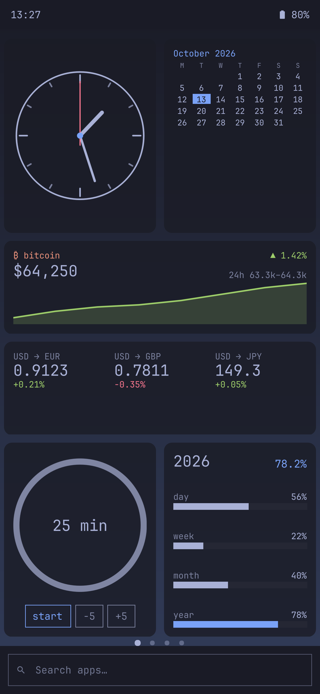
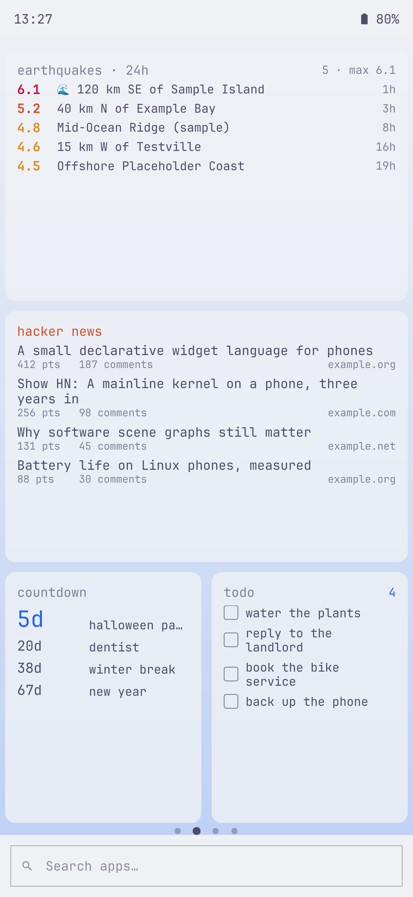
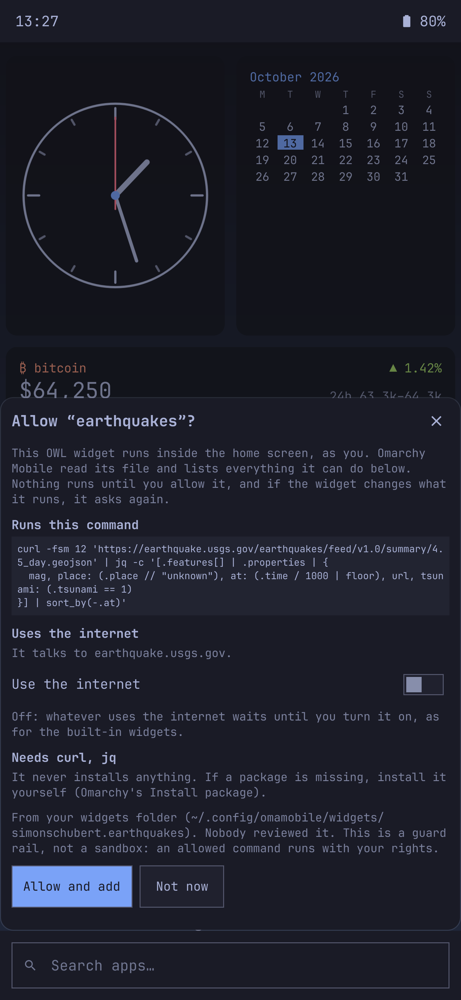
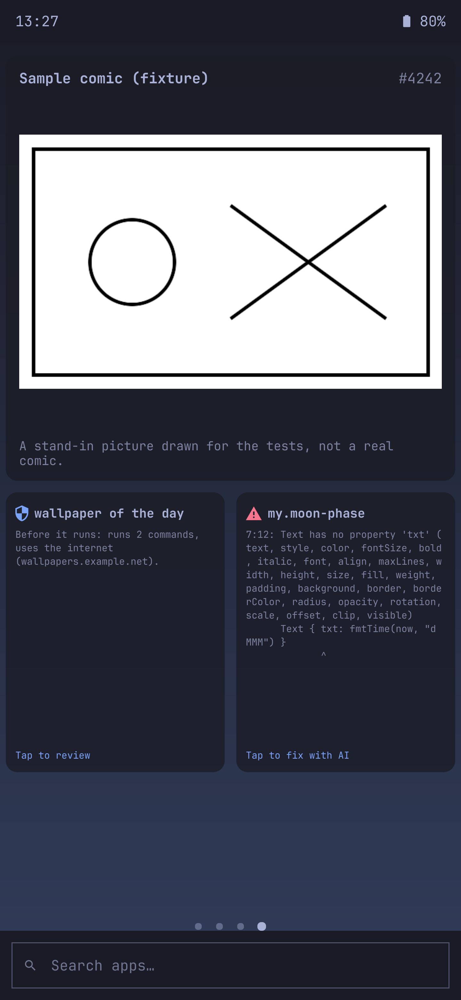
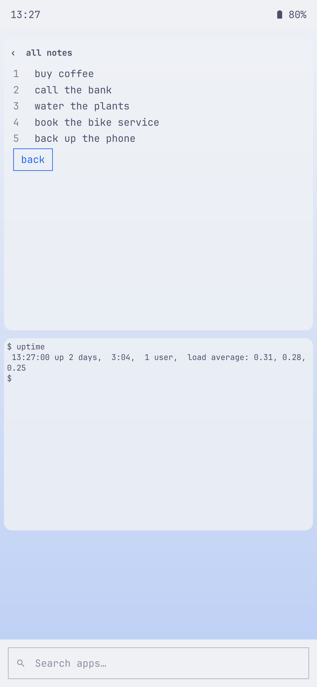
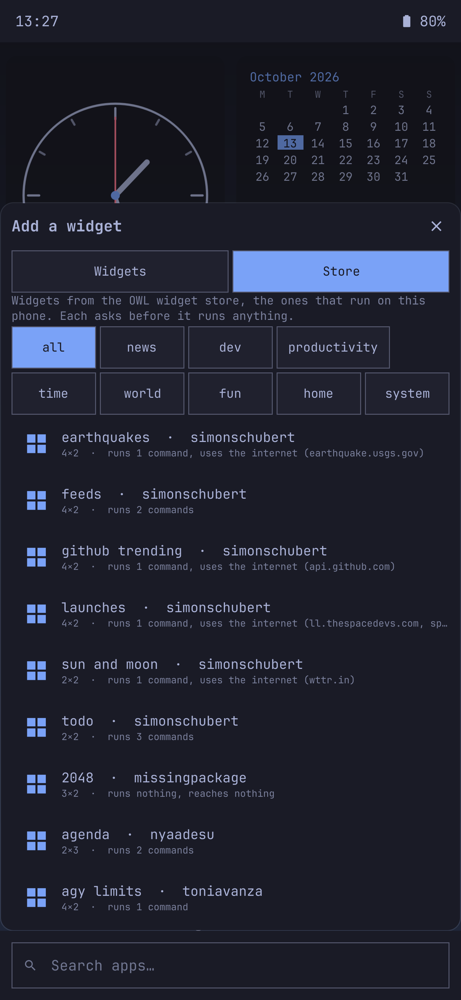
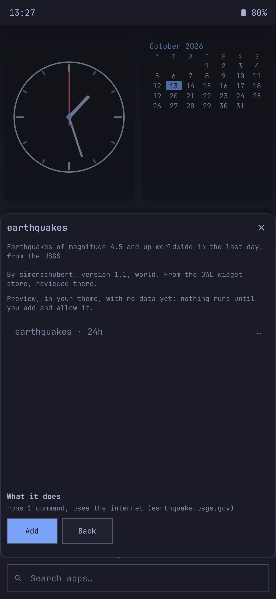
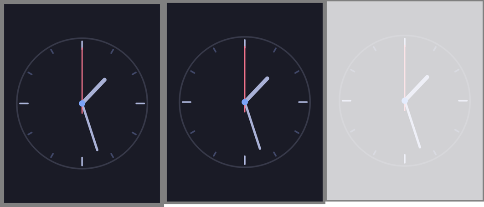
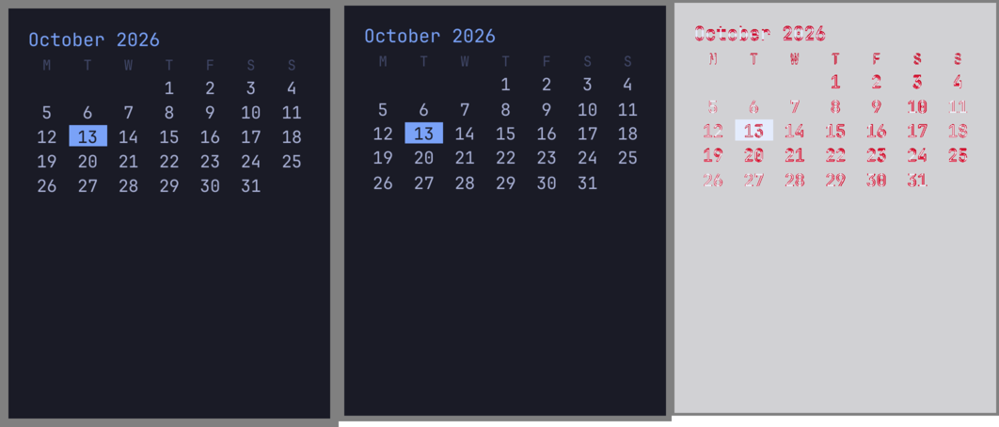

<!-- SPDX-License-Identifier: MIT -->
# OWL widgets on Omarchy Mobile: review package (milestone 1 and round 2)

**Status (2026-10-13, round 2 the same night):** built and tested on the laptop only, on branch `owl-widgets`. Round 2 added screens, `stream`, file watching, `Terminal`, the panel-off pause, haptics and the torch behind the approval sheet, the store package and its Store tab, the credited OWL guide, and layout checks for every store widget (what changed is marked **New** below). **Nothing has been installed on the phone, and nothing will be until you have reviewed this and said yes.** Everything is behind a feature flag that is off by default, so even an installed package changes nothing on its own.

This is the first milestone of [WIDGET-INTEROP-PLAN.md](../WIDGET-INTEROP-PLAN.md), option (c): **our own OWL runtime**, written from the language guide, held to Simon Schubert's runtime by a conformance suite that runs his only as a black box inside a container. None of his code is in our tree.

Contents: [how it works on the phone](#how-it-works-on-the-phone) · [the Store tab](#the-store-tab-new) · [screenshots](#screenshots) · [how faithful it is](#how-faithful-it-is) · [tests](#tests) · [what is not done](#what-is-not-done-yet) · [trying it on the phone](#trying-it-on-the-phone-only-after-your-ok) · [questions for Simon](#questions-for-simon) · [the next phases](#the-next-phases)

---

## How it works on the phone

### Turning it on

OWL widgets stay invisible until `~/.config/omamobile/features.json` holds:

```json
{ "owlWidgets": true }
```

The home screen watches that file. With the flag off, OWL folders are not listed and a placed OWL widget shows a card saying the feature is off; QML widgets and built-ins are untouched either way.

### Adding an OWL widget

1. Put a widget in its own folder: `~/.config/omamobile/widgets/<author>.<name>/widget.owl` (for example a store widget's file). The folder rules are the same as for QML widgets: at most 64 files and 1 MiB, nothing linking outside it. `widget.owl` itself may be up to 256 KiB.
2. The scan (`omamobile-widget scan`, run by the home screen whenever the folder changes) lists the folder as an OWL widget. The home screen compiles it with our runtime.
3. Long-press, **Widgets**. OWL widgets appear under **YOURS** with an `OWL` tag, their size in our cells and what they do: "runs 1 command, uses the internet (earthquake.usgs.gov)". One that needs approval says "needs your OK: …"; one that doesn't compile shows its first error in red.
4. Tapping one that isn't approved opens the **approval sheet** (below). **Allow and add** stores the approval and places the widget; **Not now** goes back.
5. On the page it runs at once. Long-press moves and resizes it like any widget.

A widget whose file doesn't compile can still be placed: its card shows the error with line, column and a caret, and "Tap to fix with AI".

### The approval sheet

The words, as the phone shows them (screenshots: [earthquakes](screens/approve-earthquakes-tokyo-night.png), [a made-up risky widget](screens/approve-risky-tokyo-night.png)):

> **Allow "earthquakes"?**
>
> This OWL widget runs inside the home screen, as you. Omarchy Mobile read its file and lists everything it can do below. Nothing runs until you allow it, and if the widget changes what it runs, it asks again.
>
> **Runs this command** — the full text of every command, in a box.
>
> **Uses the internet** — "It talks to earthquake.usgs.gov." and a **Use the internet** switch, off by default: "Off: whatever uses the internet waits until you turn it on, as for the built-in widgets."
>
> **Reads these files** — every path.
>
> **Needs curl, jq** — "It never installs anything. If a package is missing, install it yourself (Omarchy's Install package)."
>
> **⚠ Look twice** (only when it applies, in red) — "It downloads something and runs it as a script: …", "It deletes files recursively (rm -rf): …", "runs a command built while it runs", "reads keys, tokens or passwords", "reads your notifications".
>
> From your widgets folder (~/.config/omamobile/widgets/simonschubert.earthquakes). Nobody reviewed it. This is a guard rail, not a sandbox: an allowed command runs with your rights.
>
> [**Allow and add**] [Not now]

The list on the sheet is not a guess: our compiler lists **every** command, web address and file a widget can reach, the same list (same strings, same order) the reference compiler produces (L2 below). Capabilities are derived from that list, never declared by the widget. The approval is stored per widget in `~/.config/omamobile/widget-approvals.json` as that exact list, plus the internet switch. **New:** vibration (`haptic()`) and the torch (`torch()`) are asked for the same way, under "Uses the phone": "It vibrates (a short tap, as your feedback setting allows)" and "It switches the torch on and off"; the approval records them, and a widget that starts using one asks again. A widget with a `Terminal` says "It has a terminal in its tile: what you type there runs as you." If an update changes the list, the widget stops and its card says "It changed what it runs. Before it runs: …" until you allow it again; a change to layout or text alone doesn't ask.

### What a widget can and can't do

| It can | Where the limit is |
| --- | --- |
| Run the commands listed on the sheet, with `bash -c`, as you | Only after approval; under `timeout` (default 10 s, at most 30 s); at most every 2 s; output cut at 64 KiB; a command that uses the network (curl, wget, …) waits for the internet switch |
| Fetch web addresses with `http(...)` | GET only, at most 1 MB, a timeout, at most every 60 s, only with the internet switch on, only to the addresses listed |
| Read files with `file(...)` | Listed on the sheet; at most 1 MB |
| Show pictures | Local files (`~/…`, `/…`) and pictures embedded in the widget; **never a web address** (that would be an unlisted network fetch) |
| Open a link, a terminal or an app on a tap, copy, notify, set the volume, control media | One action a second; links through `omamobile-launch` (one app per screen) |
| **New:** vibrate (`haptic()`) and switch the torch (`torch()`) | Only if the approval sheet allowed it. Vibration is feedbackd's short `button-pressed` event, so the user's feedback profile (silent, quiet) applies; the torch is the quick-settings tile's LED (`white:torch`). **Neither has been tried on the phone**: announce before the first test |
| **New:** show a longer view (`screen { }`, `screen()`) | In place of the tile, with its title and "‹" to go back, as our built-ins show their longer views (a tap on the bundesliga widget, for example); `close()` goes back. Its sources keep running while it is open |
| **New:** follow a command line by line (`stream(...)`), watch a file (`file(...)`) | Two streams at most on the home screen, stopped while the widget is hidden, restarted 5 s after they exit; files are read again when they change (inotify), not polled |
| **New:** have a terminal in the tile (`Terminal { }`) | The command (or the login shell) in a pseudo-terminal, its output as text and a line to type into; the tile is inert until tapped, so swipes still turn pages. Full-screen programs (btop) need a real terminal |
| Keep state across restarts (`state … persist`) | Per placement: the same widget placed twice keeps two states |

| It can't | Why |
| --- | --- |
| Run anything as root | A command naming `sudo`, `pkexec`, `doas`, `run0` or `su` is refused outright: the card says "Can't run on this phone" |
| Install packages | `requires { pacman: [...] }` is shown, never acted on |
| Load QML, reach the shell's objects, or import code | OWL has no way to name them; the runtime only draws its own node types |
| Hang the home screen with a loop | 200,000 evaluation steps per update, 500 nodes per tile, 2,000 drawing calls per frame, lists of 1,000; over a cap, that value shows `…` and the rest draws |
| Open Android apps or read Android notifications and alarms | No Android here (Waydroid later): `androidApp()` and `notification()` report it, `android.notifications` is empty, `android.alarm` never set |

### Theming

Colours come from the Omarchy theme's `colors.toml` with every OWL name filled in (the same derivation as the reference: all 22 bundled themes match exactly). On our card, `foreground`, `muted`, `background`, `surface`, `border` and `accent` come from the shell's own card colours, so OWL tiles read like our built-ins. A theme switch restyles them at once. Text is Omarchy's font (JetBrainsMono Nerd Font, as the launcher draws monospace). `corners` follows the theme's rounding (0 on a square theme). Compare [dark](screens/home-page1-tokyo-night.png) and [light](screens/home-page1-catppuccin-latte.png).

### Sizes

Omalauncher's grid is 6 columns of 69 dp; ours is 4x6 by default. We define one OWL dp from the phone's width (480 / 6 / 69 = 1.16 logical px), so every widget keeps the proportions it was designed with, and convert sizes: columns by 4/6, rows by pitch (69 dp = 80 px against our 151 px cells). The 14 milestone widgets:

| Widget | Store size | On our grid | Uses |
| --- | --- | --- | --- |
| simonschubert/analog-clock | 3x3 | 2x2 | Canvas, clock |
| simonschubert/calendar | 3x3 | 2x2 | Grid, clock |
| simonschubert/countdown | 3x3 | 2x2 | a command, lists |
| simonschubert/year-progress | 3x3 | 2x2 | Progress, animation |
| simonschubert/focus | 3x3 | 2x2 | Ring, buttons, state |
| simonschubert/habits | 6x3 | 4x2 | a command, persisted state, taps |
| simonschubert/earthquakes | 6x3 | 4x2 | a command with the internet, a scrolling list |
| simonschubert/hacker-news | 6x4 | 4x2 | a command with the internet, two-line items |
| simonschubert/exchange-rates | 6x2 | 4x1 | a command with the internet, Sparklines |
| derekross/bitcoin | 6x2 | 4x1 | two web requests, an area Sparkline |
| simonschubert/xkcd | 6x5 | 4x3 | a command with the internet, a picture |
| lucassynnott/year-left | 3x4 | 2x2 | Canvas with 365 squares (step budget) |
| simonschubert/todo | 3x4 | 2x2 | a command, `run()` on a tap |
| simonschubert/koi-pond | 6x3 | 4x2 | Canvas animated by `time`, sprites |

A widget reads `cols`, `rows`, `tileWidth` and `tileHeight` of **our** card, so its own `if cols < 4` layouts pick the right variant when you resize it.

### Data refresh

One clock for the whole home screen (`OwlScheduler`). **New:** `stream` and `file` sources don't wait for ticks: a line or a change updates the widget at once. The rest:: a tick on each second boundary runs whatever source is due, aligned to its period (`every 1m` turns over on the minute), and `every` triggers. Sources run only while the widget's page or a neighbour is shown and no app covers the home screen. Coming back runs everything due at once, so a widget never shows hours-old data. `at` triggers (alarms, timers) keep ticking while hidden. A tap that runs an action refreshes that widget's sources.

### Battery

* Animation (anything that reads `time`: the koi pond, a Canvas clock with a sweep) runs from a frame clock **capped at 30 fps**, and only while a shown widget actually reads `time` in what it draws now. Nothing else redraws between source updates.
* Everything stops while an app covers the home screen, and (**new**) while the panel is off: the shell reads the panel's `bl_power` (the backlight `omarchy-hw-display` names) every 2 s, the way `omamobile-keys` decides the screen is off. Streams stop with it. `at` triggers keep ticking.
* A widget whose frames take over 20 ms drops to 15 fps.
* Updates are keyed: a source that changes one number updates that one item, it doesn't rebuild the tile.
* No live effects (blur, shaders): a tinted picture is recoloured once.

The plan's P5 measurements (frame times at 120 Hz with 6 OWL tiles, CPU while hidden, an A/B drain with `tools/power-ab`) need the phone and are not done.

### When something goes wrong

| What | What you see |
| --- | --- |
| The file doesn't compile | An error card with line, column and a caret ([page 4](screens/home-page4-tokyo-night.png), "moon phase"); "Tap to fix with AI" |
| It uses something this phone refuses | An error card: "Can't run on this phone: runs a root tool: …" |
| It isn't approved, or changed what it runs | A card with a shield: "Before it runs: runs 2 commands, uses the internet (…)", "Tap to review" ([page 4](screens/home-page4-tokyo-night.png), "wallpaper of the day") |
| A value fails while it runs (over budget, a bad pattern) | That value shows `…`; the rest of the tile draws. The last 20 problems go to `~/.local/state/omamobile/owl/errors/<id>.txt` and the log |
| A command fails or times out | Its value doesn't update; stderr's first line goes to the error log |
| The widget crashes the shell | The existing crash guard: the widget is recorded while it starts; if the shell dies then, it stays off at the next start with "This widget crashed the shell, so it's off. Edit it to try again." until its file changes |

The error log lives outside the widget's folder (the plan said `.errors/` inside it): writing there would trigger the folder watcher and a rescan on every error.

### The language guide (new)

With your go, Simon Schubert's OWL language guide ships unchanged as `/usr/share/omamobile/shell/OWL.md` ([source](../../packages/omamobile-shell/widgets/OWL.md)): credited at the top with the repository and the pinned commit (`d355bdb`), its MIT licence text and copyright line intact at the end, and our notes after the guide on where this phone differs (folders, approval, grid, limits, screens in place, pictures, Android), pointing to `SPEC-NOTES.md`. `test/all` checks the copyright line and the commit stay in it. It is what an agent will read to write an OWL widget (P10).

### Creating widgets with AI (later, P10)

Today "Create a widget with AI" still makes QML widgets. In P10 it will make OWL by default: a folder with a `widget.owl` template, the agent pointed at the language guide and a short phone notes file, and `omamobile-widget check .` (or `shell call omamobile.home owlStatus <id>`, which exists now) to see compile errors, the commands list and a preview. An agent's mistake in OWL is a `…` or an error card, not a crash loop; what it can run is shown on the approval sheet before anything runs (a widget the user's own agent made is approved by making it, per the plan, but still listed). "Fix with AI" on an OWL error card currently starts the agent with the QML contract; it gets `OWL.md` in P10.

## The Store tab (new)

**The package.** `omamobile-owl-widgets` holds the omarchy-widgets store at the pinned commit `b63886b`: only the widgets that pass our conformance suite (`status.json`: 93 "ok", 12 "partial", their reasons listed), the store's order, its MIT licence, and an index our own compiler builds (name, author, description, category, version, sizes, packages, the full commands list, capabilities, each file's sha256). No preview images (Q10). It is not in `tools/build-packages` yet: that waits for your review.

**On the phone**, with OWL widgets on, the Widgets sheet has two tabs, **Widgets** and **Store** ([screenshot](screens/store-tab-tokyo-night.png)):

* the store's widgets in its order, with category chips (all, news, dev, productivity, time, world, fun, home, system); each row says its size here and what it does ("runs 1 command, uses the internet (earthquake.usgs.gov)"), "added" when you have it, "update to 1.2" when there is a newer version, or "not yet on this phone" with the reason;
* a tap opens the widget's sheet ([screenshot](screens/store-widget-tokyo-night.png)): its description, author, version and category, "From the OWL widget store, reviewed there", a **preview drawn on the phone in your theme with no data** (nothing runs: no commands, no requests), what it does, and **Add**;
* **Add** copies its `widget.owl` into `~/.config/omamobile/widgets/<author>.<name>/` (`omamobile-widget store-copy`), remembering where it came from in a dotfile, and opens the approval sheet. Nothing runs before you allow it;
* **Update** replaces only an unmodified copy (its file still has the sha256 it was copied with); a copy you or your agent changed is never overwritten. If the update changes what it runs, it asks again;
* **Check the store now** (`omamobile-widget store-fetch`) is the only network fetch of widget code, and only when tapped: it downloads the store's `index.json` and widget files from GitHub Pages into `~/.cache/omamobile/owl-store/`, drops any file whose sha256 doesn't match the index, and newer versions then show as updates. The store's own `index.json` format isn't documented; the fetch reads `id`, `version` and `sha256` and needs checking against the real file (a question for Simon). Its tests mock the network; nothing in the shell fetches anything on its own.

---

## Screenshots

Rendered offscreen in the conformance container at the phone's resolution (1440x3120, scale 3, logical 480x1040, the shell's real geometry: 44 px bar, 72 px dock, 4x6 grid). The home cells, the Widgets sheet and the approval sheet are the real `OwlCell`, `OwlView` and `HomeSheets` code with Omarchy's own `Commons`/`Ui` modules, over a stand-in for `Home.qml` that answers sources from fixtures. **The status bar, the dock and the wallpaper are plain stand-ins.** All data is made up for the tests (no real feeds, accounts, places of yours or identifiers).

| | Dark (tokyo-night) | Light (catppuccin-latte) |
| --- | --- | --- |
| Page 1: clock, calendar, bitcoin, exchange rates, focus, year progress | [page 1](screens/home-page1-tokyo-night.png) | [page 1](screens/home-page1-catppuccin-latte.png) |
| Page 2: earthquakes, hacker news, countdown, todo | [page 2](screens/home-page2-tokyo-night.png) | [page 2](screens/home-page2-catppuccin-latte.png) |
| Page 3: koi pond, habits, year left | [page 3](screens/home-page3-tokyo-night.png) | [page 3](screens/home-page3-catppuccin-latte.png) |
| Page 4: xkcd (a stand-in picture), a widget waiting for approval, an error card | [page 4](screens/home-page4-tokyo-night.png) | [page 4](screens/home-page4-catppuccin-latte.png) |
| The Widgets sheet with OWL widgets | [sheet](screens/widgets-sheet-tokyo-night.png) | [sheet](screens/widgets-sheet-catppuccin-latte.png) |
| Approval: earthquakes | [approve](screens/approve-earthquakes-tokyo-night.png) | [approve](screens/approve-earthquakes-catppuccin-latte.png) |
| Approval: a made-up risky widget (`curl … \| bash`, `rm -rf`) | [approve](screens/approve-risky-tokyo-night.png) | [approve](screens/approve-risky-catppuccin-latte.png) |
| **New:** a screen opened in place (a made-up notes widget) and a Terminal tile (a canned session; nothing runs) | [screen](screens/screen-and-terminal-tokyo-night.png) | [screen](screens/screen-and-terminal-catppuccin-latte.png) |
| **New:** the Store tab | [store](screens/store-tab-tokyo-night.png) | [store](screens/store-tab-catppuccin-latte.png) |
| **New:** a store widget's sheet with its preview | [widget](screens/store-widget-tokyo-night.png) | [widget](screens/store-widget-catppuccin-latte.png) |

   

  

**Ours against the reference**, one picture per widget in [`side-by-side/`](side-by-side/): our tile, the reference runtime's tile, and their difference (red), at the same card size, theme, fonts and data.

 

---

## How faithful it is

`tools/owl-conformance --live --render` (output in [conformance.txt](conformance.txt), [render-report.json](render-report.json) and [render-all.json](render-all.json)), with the reference at omarchy-widgets `b63886b`:

| Level | What | Result |
| --- | --- | --- |
| L1 compile | Accepted or rejected alike, rejects at the same line and column | **105/105** store widgets, **14/14** milestone widgets, **20/20** malformed probes |
| L2 capabilities | The same commands list, same strings and order; same derived capabilities | **105/105**, **14/14** |
| L3 evaluation | Every evaluated property and drawing call, as JSON, numbers to 1e-9 | **105/105** store widgets without data; **14/14** with data; **5/5** expression probes (about 300 expressions) |
| Palette | Our theme derivation against the reference's, every bundled Omarchy theme | **22/22** identical |
| L4 layout, with data | Every node's box within 1 dp (Text 2 dp) | **14/14** (worst 0.5 dp, calendar). **New:** the calendar miss is fixed by two general rules found by probing the reference: text is drawn at whole-pixel font sizes with lines 1.17 em of that, and a grid's rows round up to whole pixels |
| L4 layout, every store widget without data (**new**) | The same, at each widget's size on our home screen | **104/105**. Not compared: `thedavidcoen/terminal-profiles` (the reference's Terminal would start the widget's program; ours renders) |
| L5 pixels | Share of pixels more than 10% apart | With data: 0% (clock, year left, koi pond: identical) to 1.4%. Without data: **104/105** at 2% or less. Reviewed by eye in `side-by-side/` |

Round 2 found three more general rules while widening L4 (SPEC-NOTES N35, N36): a Box never gives a child more room than it has; `offset` moves a node's box where it is drawn; and **the reference renderer's `tileWidth`/`tileHeight` leave out the tile's padding, where the guide says they include it**. We keep the guide's meaning on the phone, and the comparison gives both sides the reference's (question 7 below); that convention alone accounted for six of the nine misses.

Where the guide was silent we followed what the reference does and wrote the rule in our own words in [`owl/SPEC-NOTES.md`](../../packages/omamobile-shell/plugins/omamobile.home/owl/SPEC-NOTES.md) (N1-N38). One deliberate difference: `on x { }` doesn't fire for x's first value, as the guide says (the reference fires; N8).

The reference outputs for the milestone widgets and our probes are recorded once as our expectations (`tests/owl/expected/`, `packages/omamobile-shell/test/owl-probes/*.expected.json`), so our unit tests check them without the container.

### Store widgets that can't run fully here

All 105 compile and pass L1-L3. 93 ship as "ok". These 12 ship as "partial" and say why in the Store tab:

| Widget | Why |
| --- | --- |
| asphyksia/companion, simonschubert/lava-lamp | draw a `Shader`'s fallback colour (AGSL is Android's) |
| bryanperdana/retro-amp, hoangitk/vlc-player, im0001gt/tesla, iosue-iulianus/loyalty-card, jonasallencodes/digital-clock, rcrohmana/classic-clock | open Android apps (`androidApp()`): no Android here until Waydroid |
| luciano-sparti/timetree, petllama/gestures, simonschubert/notifications | read or act on Android notifications (and app icons) |
| simonschubert/fetch | offers to install Linux, which is always there |

None is refused. A widget that names a root tool would be ("unsupported", not shipped); none in the store does.

## Tests

| Suite | Result |
| --- | --- |
| `packages/omamobile-shell/test/all` | all pass (164 checks), including `owl-core.js` (58 tests) and `widget-tool.py` (20, with **new** store copy/update tests and a store fetch against a mocked network) |
| `test/owl-core.js` | probes against the recorded reference outputs, error positions and carets, level rules, the commands list, constant folding, number printing, `sh()` through bash with hostile input, the caps (steps, nodes, drawing calls, lists, self-feeding triggers, the trigger limit), history/prev/persist, `at` after a restart, actions, `time`, dp and sizes, palette, capabilities and risks, source limits, layout, card states; **new:** the haptic/torch/volume/media argv, the android.* parsers, panel off, the terminal's output, screens, the Store tab's rows |
| **New:** `tests/owl/render/host-test.qml` (Quickshell in the container, mocks) | 13/13: haptics and the torch do nothing without approval and capture the right argv with it (nothing vibrates or lights), one action a second, a stream gives a value per line and stops, a watched file is read again when it changes, a terminal session shows its output and ends, a stream updates the tile, `screen()` opens the screen and `close()` goes back, a hidden widget stops its stream |
| **New:** `packages/omamobile-owl-widgets/test/all` (a made-up store) | 3/3: store order, the index with what each widget runs, only what passes ships |
| `tests/owl/lint/new-warnings` | no new qmllint warnings on **Qt 6.11.2** and **Qt 6.12.0**; new code in `Home.qml`/`HomeSheets.qml` follows those files' existing unqualified-id pattern (65 accesses, reported as a count) |
| `tools/owl-conformance --live --render` | above |

## What is not done yet

| Gap | Phase |
| --- | --- |
| `onDrag` competes with the page swipe; not tuned on the phone | P6 |
| An OWL `Input` takes the keyboard (the surface asks for focus), not tried with squeekboard on the phone | P6 |
| A screen opens in the tile's own cell, so a 2x2 widget's screen is small; a larger in-place view is a design choice for you | P6 |
| `share()` copies to the clipboard; `androidApp()`, `notification()` do nothing (no Android) | P5 / Waydroid |
| `omamobile-widget check` for OWL, the node checker, an IPC preview for agents | P7 |
| `omamobile-owl-widgets` in `tools/build-packages`; the real store `index.json` format for "Check the store now" | P8 (your call, Simon) |
| Replacing the 47 hand ports | P9 |
| AI creation in OWL (now with `OWL.md`), shared links | P10 |
| **Everything on the phone**: frame times at 120 Hz, CPU while hidden or with the panel off, a battery A/B, the first haptic and torch test (announced), squeekboard with Input | on the phone, after your OK |

## Trying it on the phone (only after your OK)

Nothing here has been run on the phone. If you approve, the steps would be (each announced before it runs, since it redraws the screen):

| Step | Command | Expect | Stop if | Rollback | Risk |
| --- | --- | --- | --- | --- | --- |
| 1 | Build and install `omamobile-shell` from `owl-widgets` (`tools/phone-install-package packages/omamobile-shell`), then `omarchy-restart-shell` | The home screen looks exactly as before (flag off) | Anything on the home screen changed | Reinstall the `main` package | Low: shell restart |
| 2 | Copy one widget without commands (analog clock) to `~/.config/omamobile/widgets/simonschubert.analog-clock/widget.owl`; write `{"owlWidgets": true}` to `~/.config/omamobile/features.json` | It appears under Widgets; Allow and add; it ticks | The shell restarts, or the guard holds it back | Remove `features.json` | Low |
| 3 | Add the koi pond; watch frame times and CPU with the page shown, covered by an app, and with the panel off | 30 fps at most while shown, nothing while covered or off | Stutter in the page swipe | Remove the widget | Low |
| 4 | Add earthquakes; allow it with the internet off, then on | No request until the switch is on | A request with the switch off | Revoke in `widget-approvals.json` | Low |
| 5 | Build and install `omamobile-owl-widgets` (`tools/phone-install-package packages/omamobile-owl-widgets`); open Widgets, Store; add one widget from it | The Store tab lists the store; Add opens the approval sheet | A crash opening the tab | Remove the package | Low |
| 6 | **Announced first:** a made-up widget with `Button { onTap: haptic() }`; allow it; tap once | One short tap, as the feedback profile allows | Repeated or long vibration | Remove the widget; `fbcli` events stop | Low; it buzzes in your hand |
| 7 | **Announced first:** the same with `torch("toggle")`; tap twice | The torch on, then off | The torch stays on | `brightnessctl --device=white:torch set 0` | Low; light |
| 8 | A widget with a `screen { }` and one with a `Terminal` (bash); open and close the screen; type `uptime` in the terminal | The screen opens in place with "‹"; the terminal answers | The keyboard doesn't come up, or swipes stop working | Remove the widgets | Low |

## Questions for Simon

From the plan (§10.2), still open: Q1 a versioned spec in the store repository, Q2 runtime-neutral fixtures, Q3 a capability summary in `index.json`, Q4 typed settings, Q5 time format, Q6 a coarse location source, Q7 theme tokens and card overrides, Q8 a non-Android "open" path for shared links, Q9 catalogue governance, Q10 preview licensing, Q11 naming.

New from writing a second runtime against the guide:

1. **`on x { }` and the first value.** The guide says it doesn't fire for the first value and null doesn't count; the Quickshell runtime fires when a source first loads. Which is right? (We follow the guide.)
2. **Week start for `e`/`c` in `fmtTime`.** The jar leaves it to the launcher (the phone's locale); the calendar widget is drawn for Monday, the oracle runs Sunday. Could the spec say "the user's first day of the week"?
3. **Whole pixels.** The Quickshell runtime draws text at whole-pixel font sizes and rounds grid rows up to whole pixels; we now do the same. Is that what the launcher does, and should the spec say so?
4. **Division by zero gives 0** and **`alpha()` keeps the theme name** (so `alpha(accent, 0.5)` prints as `accent`): both in the jar, neither in the guide. Can they go into the spec?
5. **`Image { src: "https://…" }`** isn't in the guide's list (asset, path, app icon). We refuse web addresses in pictures, since they would be network access nobody approved. Is that the intent?
6. **The commands list as the approval surface.** We approve the exact list the compiler prints. Would you keep those strings stable across jar versions (or version them), so an update of the jar doesn't make every widget ask again?
7. **`tileWidth` and `tileHeight`.** The guide says they include the tile padding; the Quickshell runtime reports the content area without it. Which is right? (We follow the guide; six store widgets size themselves from these.)
8. **The store's `index.json`.** What is its format, and does it carry each file's sha256? "Check the store now" verifies every file against the index when it can.

## The next phases

Estimates from the plan, revised by what milestone 1 and round 2 did (one developer; phone steps need you):

| Phase | Remaining work | Estimate |
| --- | --- | --- |
| P1-P4 | Done: L1-L3 for all 105, L4/L5 104/105 without data and 14/14 with; fixtures with data for more widgets as needed | 1 d |
| P5 sources, scheduler, host | Done offline; **phone measurements** (frame times, CPU hidden/off, battery A/B), first haptic and torch tests | 1-2 d, on the phone |
| P6 home integration | onDrag rules, Input with squeekboard, instances that outlive layout edits, "fix with AI" for OWL | 2 d |
| P7 scan, check, approval | `omamobile-widget check` for OWL (node), IPC preview for agents, crafted bad widgets on the phone | 2 d |
| P8 catalogue | Done offline; add to `tools/build-packages`, confirm the store's `index.json` with Simon | 0.5 d |
| P9 ports | Replace the 47 hand ports where the upstream widget passes | 4-5 d |
| P10 AI creation and links | OWL template, `OWL.md` (shipped), prompt, shared links | 3-4 d |
| P11 Terminal | Done offline (a line-based terminal); a real terminal for full-screen programs later | 1 d |

About **15-18 days** remain to the plan's full scope; **4-6** to a first release with store widgets and approval on the phone (P5 measurements, P6, P7 and the P8 build entry).

## Where things are

| Path | What |
| --- | --- |
| `packages/omamobile-shell/plugins/omamobile.home/owl/` | The runtime: `values.js`, `lexer.js`, `parser.js`, `builtins.js`, `compiler.js`, `runtime.js`, `layout.js`, `paint.js`, `phone.js`, `catalog.js`, the QML node items, `OwlView`, `OwlWidget`, `OwlScheduler`, `SPEC-NOTES.md` |
| `packages/omamobile-shell/plugins/omamobile.home/OwlCell.qml`, `OwlPhoneHost.qml` | The home-screen cell and the phone host (limits, commands, requests, state) |
| `Home.qml`, `HomeSheets.qml`, `UserWidgets.js`, `bin/omamobile-widget` | The flag, approvals, the Widgets sheet rows, the approval sheet, the scan's OWL branch |
| `packages/omamobile-shell/test/owl-*.js`, `owl-probes/` | Unit tests, our probes and their recorded reference outputs |
| `packages/omamobile-shell/widgets/OWL.md` | Simon's OWL guide, credited, with our notes (installed as `/usr/share/omamobile/shell/OWL.md`) |
| `packages/omamobile-owl-widgets/` | The store package: `status.json` (what ships and why not), `build-index.js`, `install`, its tests |
| `tests/owl/` | The conformance container, fixtures, recorded expectations, `conformance.js`, `render/` (L4/L5 and these screenshots), `lint/new-warnings` |
| `tools/owl-conformance` | Runs it all on the laptop: `--live`, `--record`, `--render` |
